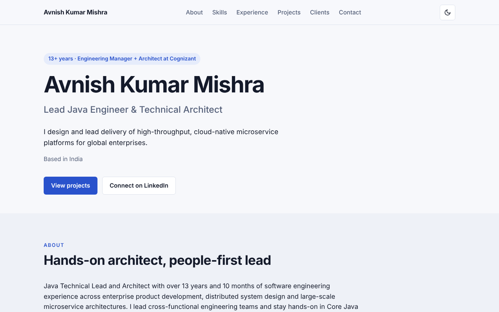
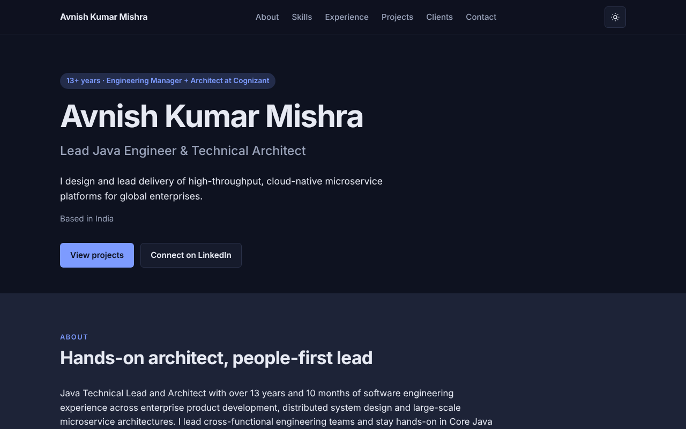

# Avnish Kumar Mishra — Portfolio

The personal portfolio site of Avnish Kumar Mishra, Lead Java Engineer & Technical Architect. It presents the profile, skills, experience timeline, projects (filterable by type and domain), clients and contact details.

Technically, it is a static React + Vite + TypeScript single-page app. The content is loaded at runtime from JSON files, behind a service layer that can be switched to a real backend later. The site is served by nginx in Docker and exposed publicly through ngrok.

**Live demo:** not published yet. A link will be added here once the ngrok or static-hosting URL is stable (see `tasks.md`, T8.3).

| Light theme | Dark theme |
|-------------|------------|
|  |  |

The theme follows the visitor's system setting and can be switched with the toggle in the top-right corner.

- Work tracker: [`tasks.md`](tasks.md)
- Decision log (read first when resuming): [`decisions/`](decisions/README.md)

## Run with Docker (production)

```bash
cp .env.example .env          # add NGROK_AUTHTOKEN (and NGROK_DOMAIN if you have one)
docker compose up --build -d  # web on http://localhost:8080 + ngrok tunnel
```

- Public URL: open the ngrok inspector at http://localhost:4040 or run `docker compose logs ngrok`.
- Local only (no ngrok): `docker compose up --build -d web`
- Health check: `curl localhost:8080/healthz`
- Stop: `docker compose down`

## Develop locally

```bash
cd frontend
npm install
npm run dev     # http://localhost:5173
npm test        # vitest
npm run lint
npm run build
```

## Editing content

All content lives in `frontend/public/data/`:

| File | Contents |
|------|----------|
| `profile.json` | name, title, summary, stats, links |
| `skills.json` | technical + functional skill groups |
| `experience.json` | roles / employers / clients timeline |
| `projects.json` | projects with type, domain, client, impact |

The shapes are defined in `frontend/src/types/portfolio.ts`. Data is baked into the image, so run `docker compose up --build -d` after editing. nginx serves `/data/` with `no-cache`, so visitors get the new content straight away.

## Updating the screenshots

The images in `docs/screenshots/` are 1280×800 captures of the top of the home page, taken from a production build served with `npm run build && npx vite preview` in `frontend/` with the browser's color scheme set to light and dark. Retake them after a visible change to the hero section or the theme.

## Adding a backend later

See [decisions/0002](decisions/0002-data-layer-backend-ready.md). In short:

1. Implement `GET /api/v1/{profile,skills,experience,projects}` returning the types in `src/types/portfolio.ts`.
2. Uncomment the `backend` service in `docker-compose.yml` and the `/api/` block in `docker/nginx.conf`.
3. Set `VITE_DATA_SOURCE=api` in `.env` and rebuild. No component changes are needed.

## Layout

```
decisions/           ADRs
docs/screenshots/    README screenshots (light / dark)
docker/              Dockerfile, nginx.conf
frontend/
  public/data/       content (runtime JSON)
  src/types/         domain contract
  src/config/        env config
  src/services/      httpClient, PortfolioService (static | api), factory
  src/hooks/         useAsync, usePortfolio
  src/components/    shared UI
  src/sections/      page sections
  src/utils/         filtering / derivations
  src/__tests__/     vitest
```
