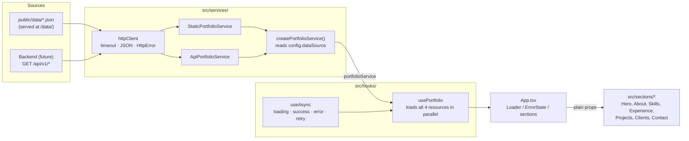
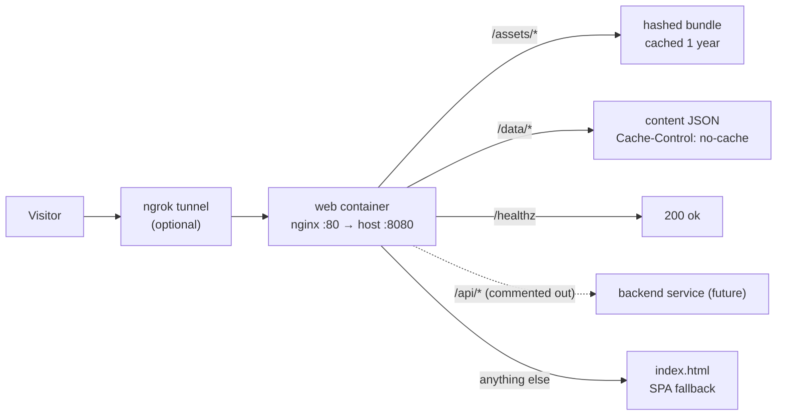

# Architecture

How content gets from JSON (or, later, a backend API) onto the page, and how the `static` / `api` switch works.
The reasoning behind this design is in [decisions/0002](../decisions/0002-data-layer-backend-ready.md); this page
describes how the code is wired today.

## Data flow

Layer by layer:

| Layer | File(s) | What it does |
|-------|---------|--------------|
| Types | `src/types/portfolio.ts` | The contract: `Profile`, `Skills`, `Experience`, `Project` and `PortfolioData`. Both data sources must return these shapes. |
| Config | `src/config/env.ts` | `readConfig()` turns `VITE_*` variables into an `AppConfig` (`dataSource`, `apiBaseUrl`, `requestTimeoutMs`). |
| HTTP | `src/services/httpClient.ts` | `createHttpClient()` makes GET requests with a base URL, a timeout (default 10 s), an `Accept: application/json` header and optional extra headers via `getHeaders`. Every failure becomes an `HttpError` (`status` is `null` for timeouts and network errors), except when the caller aborts the request. |
| Service interface | `src/services/portfolioService.ts` | `PortfolioService` has `getProfile`, `getSkills`, `getExperience` and `getProjects`, and each one takes an optional `AbortSignal`. The UI depends only on this interface. |
| Implementations | `staticPortfolioService.ts`, `apiPortfolioService.ts` | Static reads `/data/{profile,skills,experience,projects}.json`; API reads `/api/v1/{profile,skills,experience,projects}`. |
| Factory | `src/services/index.ts` | `createPortfolioService(config)` picks the implementation and exports a single `portfolioService` instance. |
| Hooks | `src/hooks/useAsync.ts`, `usePortfolio.ts` | `useAsync` runs an abortable loader and exposes `status`, `data`, `error` and `retry`. `usePortfolio` uses it to fetch all four resources with `Promise.all`. |
| UI | `src/App.tsx`, `src/sections/`, `src/components/` | `App` shows `Loader` while loading, `ErrorState` (with a retry button) on failure, and otherwise passes plain data to each section. Sections never call services. |
| Derivations | `src/utils/projects.ts` | Pure functions used by sections: project filtering, unique filter values and the "Clients served" summary. |

### Request lifecycle

1. `App` mounts and calls `usePortfolio()`.
2. `useAsync` creates an `AbortController` and calls the loader with its signal.
3. The loader calls the four service methods in parallel. Each one goes through the `httpClient`, which links the
   caller's signal to its own timeout controller.
4. If all four succeed, the state becomes `success` and `App` renders the sections. If any fails, the state becomes
   `error` and the first error's message is shown. **Try again** calls `retry()`, which runs the loader again.
5. If `App` unmounts during the requests, the controller aborts them and the result is ignored.

## The `static` vs. `api` switch

The data source is chosen by `VITE_DATA_SOURCE`:

| Value | Implementation | Requests go to |
|-------|----------------|----------------|
| `static` (default, and any unknown value) | `StaticPortfolioService` | `/data/*.json`, same origin, no base URL |
| `api` | `ApiPortfolioService` | `${VITE_API_BASE_URL}/api/v1/*` |

Related settings:

- `VITE_API_BASE_URL`: used only in `api` mode. Empty (the default) means same origin, so nginx can proxy `/api/`
  to the backend without CORS. Trailing slashes are removed.
- `VITE_REQUEST_TIMEOUT_MS`: request timeout for both modes (default `10000`).

These are **build-time** values: Vite inlines `VITE_*` variables into the bundle, so changing them means rebuilding.

- Local dev: set them in `frontend/.env` (see `frontend/.env.example`), then restart `npm run dev`.
- Docker: `docker-compose.yml` passes `VITE_DATA_SOURCE` and `VITE_API_BASE_URL` from the root `.env` to
  `docker/Dockerfile` as build args, so run `docker compose up --build -d` after changing them.
  `VITE_REQUEST_TIMEOUT_MS` isn't passed as a build arg, so Docker builds use the default.

To switch to a backend, follow the steps in the README's "Adding a backend later" section. No component changes are
needed, because the UI only sees `PortfolioService` and the types.

## Serving

The image is built in two stages ([ADR 0004](../decisions/0004-docker-nginx-serving.md)): Node builds the bundle,
then nginx serves `dist/` using `docker/nginx.conf`. The content JSON is copied into the image along with the
bundle, so editing it needs a rebuild. Because `/data/` is served with `no-cache`, browsers pick up the new content
straight away.

## Tests

`src/__tests__/` covers the pieces above: `services.test.ts` (`readConfig`, the factory's choice of
implementation for both modes and the static service, with a mocked `fetch`), `projects.test.ts` (the pure functions in
`utils/projects.ts`) and `App.test.tsx` (a render smoke test using `fixtures.ts`).
